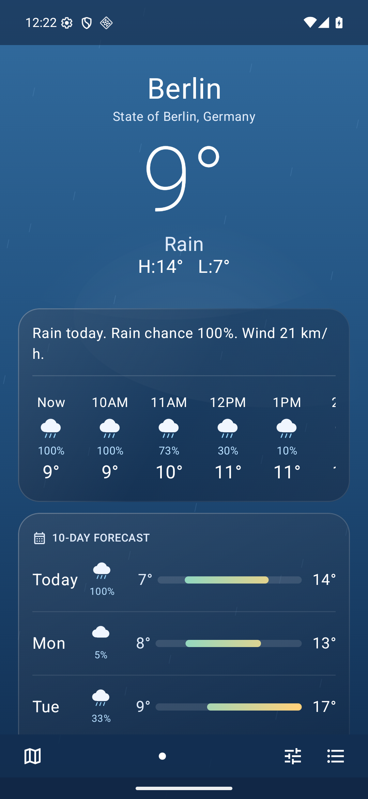
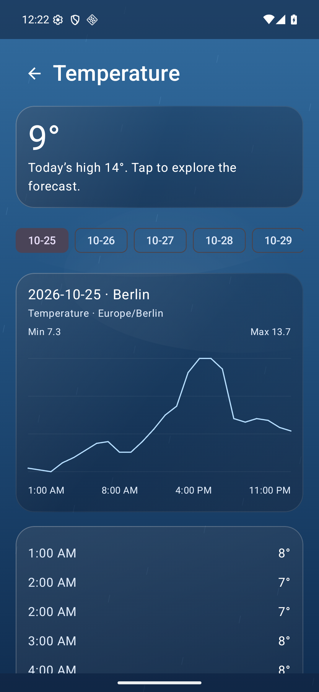
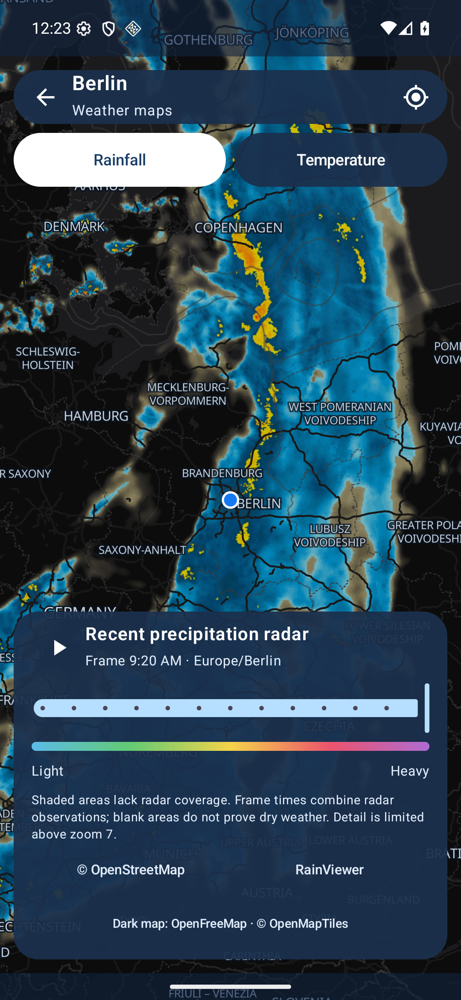

<h1 align="center">Weather for Android</h1>

<p align="center">A calm, open-source weather app for Android.</p>

<h2 align="center">Download</h2>

<p align="center">
<a href="https://github.com/Kian-hdr/Weather/releases/download/v1.1.1/Weather_v1.1.1.apk"></a>
</p>

<p align="center"><a href="https://github.com/Kian-hdr/Weather/releases/download/v1.1.1/Weather_v1.1.1.apk">APK · v1.1.1</a></p>

<p align="center"><a href="https://github.com/Kian-hdr/Weather/releases/tag/v1.1.1">Release notes</a></p>

A calm, open-source weather app created by **Kian Konrad Tajbakhsh**. Detailed forecasts, translucent glass cards, an animated sky and a clean white icon. No ads, accounts or analytics.

[MIT license](LICENSE) · [Privacy](PRIVACY.md)

## Screenshots

Actual app captures from an Android emulator. Forecast and map images show the provider data available at capture time; they are not a current weather report.

| Forecast | Weather details | Rainfall radar |
| --- | --- | --- |
|  |  |  |

Forecasts: [Open-Meteo](https://open-meteo.com/). Radar: [RainViewer](https://www.rainviewer.com/). Maps: [OpenFreeMap](https://openfreemap.org/), [© OpenStreetMap contributors](https://www.openstreetmap.org/copyright) and [© OpenMapTiles](https://openmaptiles.org/). [Full attributions](THIRD_PARTY_NOTICES.md).

[View the in-app creator and license screen](docs/screenshots/Licenses.png).

## Features

- Current conditions, hourly outlook and a 10-day forecast with detailed charts.
- Temperature, feels-like, precipitation, wind, humidity, dew point, UV, visibility, pressure, sunrise/sunset and modeled air quality.
- Worldwide city search, saved cities and optional foreground location.
- Metric and imperial units.
- Offline estimates that follow the current time using the last downloaded hourly forecast. Values between valid hourly samples are interpolated; the screen shows the estimate and original download time. The app stops estimating when the cached forecast runs out.
- Recent rainfall radar, playback and a sampled regional temperature map.
- Original white sun/cloud icon, including adaptive and monochrome variants.

## Install

1. Open [Releases](https://github.com/Kian-hdr/Weather/releases/latest) and download `Weather_v1.1.1.apk`.
2. Open the APK on an Android phone and allow installation from your browser or file manager if Android asks.
3. Choose a city or tap **Use my location**. Location permission is optional.

Android 9 or newer is required. This is a direct APK release, not a Google Play listing. Download updates from this repository; there is no automatic updater. Install over an existing official build to keep saved cities and settings. A fork signed with another key cannot replace the official app.

You can verify the APK against the `SHA256SUMS.txt` file on the release page. Official releases use signing certificate SHA-256:

```text
d3370a7978ab64640b64af5be1ceca607eebc683cb0c3d47dd02dd0e7e23f5c3
```

## Build from source

Requirements: JDK 17 or newer, Android SDK Platform 37 and Build Tools 37.0.0. The app targets API 36 and supports API 28+. Kotlin, Jetpack Compose, MapLibre Native and Gradle versions are pinned.

```sh
git clone https://github.com/Kian-hdr/Weather.git
cd Weather
./scripts/build.sh :app:assembleDebug :app:testDebugUnitTest :app:lintDebug
```

The build script uses Android Studio's bundled Java runtime on macOS when available. Otherwise set `JAVA_HOME` and `ANDROID_HOME` for your environment. Build outputs are under `~/.cache/weather/build/app/outputs/`; the Gradle project cache stays under `~/.cache/weather/gradle-project/`.

Debug builds use package `dev.kiankonrad.weather.qa`; official releases use `dev.kiankonrad.weather`. For a signed release, provide your own private `~/.config/weather/signing.properties`:

```properties
storeFile=/absolute/path/to/your-keystore.jks
storePassword=YOUR_LOCAL_PASSWORD
keyAlias=YOUR_KEY_ALIAS
keyPassword=YOUR_LOCAL_PASSWORD
```

Never commit signing properties or keys. Then run:

```sh
./scripts/build.sh :app:assembleRelease
```

For emulator tests, start an Android emulator and run:

```sh
./scripts/build.sh :app:connectedDebugAndroidTest
```

The test suite includes deterministic offline-clock fixtures and separate live-provider journeys. Fixture tests are guarded against execution on a physical phone. Live-provider tests require internet and provider availability.

## Data, privacy and limits

Forecasts and air quality are model estimates. Radar shows recent observations, not a future rain forecast, and coverage varies. The temperature map interpolates 49 regional samples and is not a street-level measurement.

This free, noncommercial app accesses Open-Meteo, RainViewer and OpenFreeMap directly. Requests reveal the selected coordinates or map area and ordinary network metadata to those providers. Saved cities, preferences and caches stay in app-private storage. There is no background location tracking. See [Privacy](PRIVACY.md).

The **MIT license covers the original app source and artwork**. Third-party software and weather/map data retain their own licenses. The included free weather endpoints have noncommercial-use and traffic limits; commercial or high-volume forks must arrange suitable provider access. See [third-party notices](THIRD_PARTY_NOTICES.md) and [dependency inventory](DEPENDENCIES.md).

## Contributing

Bug reports and focused pull requests are welcome. Include your Android version, app version and reproducible steps; avoid posting exact home locations or private data. See [CONTRIBUTING.md](CONTRIBUTING.md) and [SECURITY.md](SECURITY.md).

## License and creator

Copyright © 2026 **Kian Konrad Tajbakhsh**. Original source and artwork are released under the [MIT license](LICENSE). Bundled library notices are included in the APK under **Settings → Open-source licenses**.
